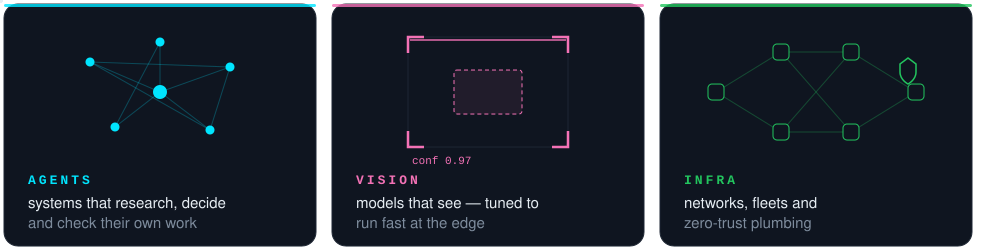

  

  

<code>// now building</code>

  

  

  

<code>// activity</code>

  

<picture>
  <source media="(prefers-color-scheme: dark)" srcset="https://raw.githubusercontent.com/DylanX404/DylanX404/output/snake-dark.svg" />
  <source media="(prefers-color-scheme: light)" srcset="https://raw.githubusercontent.com/DylanX404/DylanX404/output/snake.svg" />
  
</picture>

  

most of it ships quietly.

